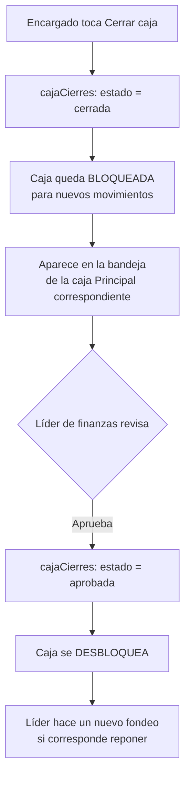

# Spec técnico: Módulo Finanzas — Fase 4 (Cajas: Principal y Chicas)

## Objetivo y alcance

Construir la gestión de **Cajas** — ya no "Caja Chica" a secas. Es una jerarquía de dos niveles: **dos Cajas Principales fijas** (una en pesos, una en dólares) desde las que se fondean **Cajas Chicas** dependientes, cada una con su responsable.

Flujo completo: la principal transfiere ("fondea") un monto a una chica → la chica registra sus propios ingresos/egresos del día a día → al cerrar, compara lo gastado contra el efectivo real que tiene en mano, y ese cierre queda como la rendición formal hacia su caja principal.

No depende de Interbanking, Vientri, ni de ningún módulo bloqueado — se puede construir y probar de punta a punta ya mismo, en el entorno de staging.

## UX: pensada para quien la usa, no para quien la programa

Quien opera la caja chica hoy tiene 55+ años y bajo manejo de tecnología — esto no es un detalle menor, define reglas duras para la pantalla del responsable (no para la del líder de finanzas, que puede ser más densa):

- **Botones grandes, con palabras simples**: "Anotar un gasto" y "Anotar un ingreso" en vez de "Registrar egreso"/"Nuevo movimiento".
- **Un solo paso por acción** — nada de asistentes de varias pantallas para algo tan simple como cargar un gasto.
- **Lista de movimientos, no una tabla técnica** — tarjetas simples (fecha, concepto, monto, foto si hay), no columnas apretadas con scroll horizontal.
- **Sacar foto del comprobante debe ser un botón directo** ("Sacar foto"), no un selector de archivos genérico — pensado para que se use desde el celular.
- **Nada de jerga financiera** en esta pantalla: "saldo" está bien, pero evitar "rendición", "conciliación", etc. — usar "¿Cuánto tengo ahora?", "Cerrar el mes".
- Confirmaciones simples: un solo "Guardar", sin pasos de doble confirmación salvo que el monto sea muy alto (a definir un umbral con el líder de finanzas si hace falta).

La pantalla de administración (crear cajas, asignar/reasignar responsable, aprobar rendiciones) es para el líder de finanzas — ahí sí puede ser más densa, ese perfil no tiene la misma restricción.

**Prerrequisito antes de producción (no ahora):** el responsable real de la única caja hoy (Sergio W) todavía no tiene cuenta en BacarNet — para pruebas en staging alcanza con un usuario de test, pero antes de usar esto en serio, alguien tiene que darle de alta una cuenta real.

## Modelo de datos (Firestore)

```
cajas (colección)
  {cajaId}
    nombre: string                     // "Caja Principal ARS", "Caja Chica Recepción"
    tipo: "principal" | "chica"
    moneda: "ARS" | "USD"
    cajaPadreId: string | null         // null si es principal; si es chica, apunta a SU principal (misma moneda)
    responsableUid: string
    saldoActualCentavos: number
    createdAt / updatedAt / createdBy

    historialCustodia (subcolección)   // igual que antes, sin cambios
      {eventoId}
        responsableAnteriorUid: string | null
        responsableNuevoUid: string
        fecha: timestamp
        motivo: string | null
        registradoPor: string (uid)

cajaMovimientos (colección)
  {movimientoId}
    cajaId: string
    tipo: "ingreso" | "egreso" | "fondeo_recibido" | "fondeo_enviado"
    concepto: string
    montoCentavos: number
    fecha: timestamp
    comprobanteUrl: string | null
    categoria: string | null
    esViatico: boolean
    beneficiarioEmpleado: string | null
    fondeoVinculadoId: string | null   // conecta el lado "enviado" (principal) con el "recibido" (chica) del mismo fondeo
    registradoPor: string (uid)
    createdAt
```

**Regla de negocio:** solo puede existir **una** caja `tipo: "principal"` por `moneda` — nunca una segunda principal en pesos o en dólares. Una caja `tipo: "chica"` siempre tiene la misma `moneda` que su `cajaPadreId`.

**Fondeo (transferencia de principal a chica):** es una sola acción atómica que crea DOS movimientos vinculados por el mismo `fondeoVinculadoId` — un `fondeo_enviado` (egreso) en la principal, y un `fondeo_recibido` (ingreso) en la chica. Nunca se hace en dos pasos separados, para que los dos lados queden siempre consistentes entre sí.

**Una caja siempre nace en $0.** No se puede fijar un saldo inicial al crearla — la única forma de que una caja chica reciba plata es un fondeo posterior desde su principal. El alta y el fondeo son siempre dos acciones separadas.

**Una caja chica no tiene botón de "ingreso" libre.** Su único movimiento de tipo entrada es `fondeo_recibido`, y ese lo genera el sistema automáticamente cuando el líder de finanzas fondea desde la principal — el encargado nunca lo carga a mano, simplemente lo ve aparecer en su lista. (La principal sí puede tener ingresos genéricos — por ejemplo, registrar un retiro de efectivo del banco — porque es la fuente original del dinero en efectivo del sistema.)

Cambiar de responsable **no borra ni reescribe nada** — solo agrega un evento a `historialCustodia` y actualiza `responsableUid`. Así, si alguna vez hay que preguntar "¿quién tenía la caja el 15 de marzo?", la respuesta está ahí, no depende de la memoria de nadie.

Cada movimiento es un registro inmutable — no se edita ni se borra un movimiento ya cargado (si hay un error, se carga un movimiento de corrección, nunca se pisa el original). Esto es la trazabilidad de Caja Chica: no hace falta un historial aparte porque cada fila ya es el historial.

## Viáticos: reutilizar infraestructura existente, no duplicar

Un viático **no es una colección nueva** — es una etiqueta sobre algo que ya existe, según de dónde sale la plata:

- **Viático en efectivo, desde una caja chica** → un `cajaMovimientos` con `tipo: "egreso"`, `esViatico: true` y `beneficiarioEmpleado` cargado.
- **Viático por transferencia, desde una cuenta bancaria** → un `compromisoPago` de Agenda (Fase 3) con `medioPago: "transferencia"`, con los mismos dos campos (`esViatico`, `beneficiarioEmpleado`) agregados al modelo ya existente.

Esto evita tener dos sistemas de pagos paralelos — Agenda ya resuelve todo lo de "pagar desde una cuenta bancaria" (incluyendo el aviso de saldo insuficiente), y Caja Chica resuelve lo de efectivo. Un viático es solo el punto de cruce entre los dos.

**Cambio necesario en Agenda (Fase 3):** agregar `esViatico: boolean` y `beneficiarioEmpleado: string | null` a `compromisosPago` — campo nuevo, no rompe nada de lo ya construido.

## Cierre de caja (antes "Rendición")

Cuando el encargado de una caja chica toca **"Cerrar caja"**, el sistema arma solo el resumen del período — comparando lo que teóricamente debería tener contra lo que realmente tiene en la mano:

```
cajaCierres (colección)
  {cierreId}
    cajaId: string                      // siempre una caja tipo "chica"
    periodoDesde / periodoHasta: timestamp
    saldoInicial: number
    totalFondeosRecibidos: number
    totalEgresos: number
    totalEgresosConComprobante: number
    totalEgresosSinComprobante: number
    saldoTeorico: number                 // inicial + fondeos - egresos
    efectivoContado: number | null       // lo que el encargado cuenta a mano
    diferencia: number | null            // contado - teórico (idealmente 0)
    estado: "borrador" | "cerrada" | "aprobada"
    aprobadaPorUid: string | null        // líder de finanzas
    createdAt / createdBy
```

Si `diferencia` no es 0, el cierre igual se puede confirmar — queda visible y marcado, no bloquea. Es información para conversar, no un error a esconder.

**Reposición:** cuando el líder de finanzas aprueba un cierre, esa es la señal para hacer un nuevo **fondeo** desde la principal correspondiente — no es un flujo aparte, es la misma acción de fondeo ya definida en el modelo de datos.

**El ciclo completo del cierre, paso a paso (para no dejar huecos):**



- **Mientras un cierre está en estado `cerrada` (esperando aprobación), esa caja chica queda bloqueada** — no se pueden cargar nuevos gastos ni ingresos hasta que el líder lo apruebe. Esto evita mezclar movimientos de un período ya cerrado con el siguiente.
- **El cierre tiene que aparecer visible en algún lado para el líder, no quedar "perdido".** Se muestra como una bandeja ("Cierres pendientes de aprobar") visible desde la caja Principal correspondiente — no alcanza con que el estado quede guardado en la base si nadie lo ve en pantalla.
- Al aprobar, la caja se desbloquea automáticamente y queda lista para operar de nuevo (con el saldo que le haya quedado, o esperando un nuevo fondeo).

## Eliminación de cajas

- **Solo el líder de finanzas puede eliminar una caja** — nunca el encargado de una caja chica.
- **Baja lógica, no borrado físico** (mismo criterio que el resto del proyecto): la caja pasa a `estado: "inactiva"`, nunca se borra el documento ni sus movimientos históricos.
- **Solo se puede dar de baja si `saldoActualCentavos = 0` y no tiene ningún cierre en estado `cerrada` esperando aprobación.** Si tiene plata, primero hay que vaciarla (gastarla o devolverla) antes de poder eliminarla — nunca se "pierde" saldo al borrar.
- **Las 2 cajas principales nunca se pueden eliminar** — son fijas por diseño.

## Endpoints y pantalla

`backend/src/modules/finanzas/cajachica/` (mismo patrón: domain / services / adapters / routes):

- `GET/POST /api/finanzas/cajas` — listar/crear cajas (principal o chica); crear una caja es exclusivo del líder de finanzas
- `DELETE /api/finanzas/cajas/:id` — baja lógica; valida saldo=0 y sin cierres pendientes; rechaza si es principal
- `POST /api/finanzas/cajas/:principalId/fondear` — hace el fondeo (crea los dos movimientos vinculados, atómico)
- `GET/POST /api/finanzas/cajas/:id/movimientos` — ingresos/egresos de una caja puntual; el backend rechaza si la caja está bloqueada por un cierre pendiente
- `POST /api/finanzas/cajas/:id/cerrar` — dispara el cierre con el resumen automático, bloquea la caja
- `GET /api/finanzas/cajas/cierres-pendientes` — la bandeja que ve el líder de finanzas
- `POST /api/finanzas/cajas/:id/cierres/:cid/aprobar` — solo líder de finanzas; desbloquea la caja

**Pantalla:** `/finanzas/cajas`. Un responsable de caja chica ve solo su(s) caja(s) — pantalla simple: saldo arriba, **un solo botón grande ("Anotar un gasto")** (sin "ingreso", eso solo lo genera un fondeo), lista de movimientos reciente, y el botón **"Cerrar caja"**. Si la caja está bloqueada por un cierre pendiente de aprobación, se ve claramente ("Esta caja está cerrada, esperando aprobación") y no deja cargar nada nuevo. El líder de finanzas ve, además, las 2 cajas principales, un selector para moverse entre todas las cajas chicas, la acción de fondear, la opción de eliminar una caja (con las validaciones ya descritas), y una **bandeja de "Cierres pendientes de aprobar"** bien visible — no un dato escondido en una tabla.

## Seguridad y permisos

Esto sí necesita permisos más finos que `view_finanzas` a secas — a diferencia de Cheques/Agenda, acá un responsable no debería ver la caja de otro:

- **Responsable de caja**: solo lectura/escritura de `cajaChicaMovimientos` donde `cajaId` esté en su lista de cajas asignadas (campo `responsableUid` en `cajasChicas`, o una lista si en el futuro una persona maneja más de una).
- **Líder de Finanzas**: lectura y aprobación de todas las cajas, sin restricción.
- Firestore Security Rules deben reflejar esta separación por caja — no alcanza con `view_finanzas` genérico como en los módulos anteriores.

* **Solo el líder de finanzas puede crear cajas** (principales o chicas) y **ejecutar un fondeo** — un responsable de caja chica no puede fondearse a sí mismo ni crear cajas nuevas.

## Checklist de aceptación (Definition of Done)

- [ ] Colección `cajas` con `tipo` (principal/chica) y `cajaPadreId`
- [ ] Regla: una sola caja principal por moneda; toda caja nace con saldo $0
- [ ] Fondeo: crea los dos movimientos vinculados en una sola operación atómica
- [ ] Caja chica sin botón de "ingreso" libre — solo egreso y fondeo\_recibido automático
- [ ] Botón "Cerrar caja" con resumen automático (teórico vs. efectivo contado)
- [ ] Caja bloqueada mientras su cierre esté "cerrada" (sin aprobar) — rechazo real del backend, no solo la UI
- [ ] Bandeja "Cierres pendientes de aprobar" visible para el líder de finanzas
- [ ] Aprobar un cierre desbloquea la caja
- [ ] Eliminar caja: baja lógica, solo líder, solo si saldo=0 y sin cierres pendientes; principales nunca eliminables
- [ ] Selector de personas (no UID) para responsable y reasignación
- [ ] Firestore Security Rules: separación por caja, ya confirmada con test real
- [ ] Al menos un test unitario del cálculo de cierre
- [ ] Probado en staging de punta a punta: crear, fondear, gastar, cerrar, aprobar, y confirmar que la caja se desbloquea
